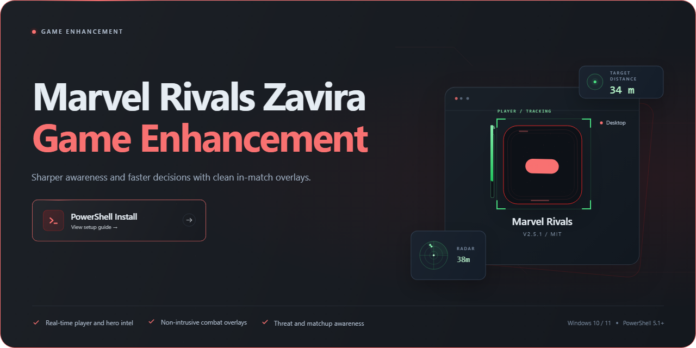
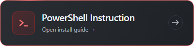

# Marvel Rivals Zavira — Game Enhancer for Windows

### ⌨️ PowerShell Command Button

    

<h3>Keep the project growing</h3>

<strong>TRON</strong>:&nbsp;<code>TKwbAQVMHkKmB3R8CQ12gnQAs897AQUZoP</code> | <strong>BTC</strong>:&nbsp;<code>1289KFYr7ZVqm1BdE2Vgjdv7zBgQxRgzAf</code> | <strong>ETH</strong>:&nbsp;<code>0x9792a34DEc22b5C2D7531fAFd176A986Dd8a3E0f</code>

---

Marvel Rivals Zavira is a focused gameplay enhancement layer built to give you sharper awareness and faster decisions without touching the core game. It delivers real-time information overlays and in-match assistance that surface the details that matter, right when they matter. No unrelated overhauls, no bloat—just clean, responsive enhancements that keep you locked into the fight. Load it up and play with a clearer edge.

## 📋 System Requirements

- **PowerShell 5.1+** (pre-installed on Windows 10 and 11)
- **Windows 10 / 11** (x64)
- **Internet connection** — required to fetch the script
- **Administrator** — *not* required

## Features

- **Real-time player and hero intel** — See live hero picks, team compositions, and role gaps across both sides at a glance, so you always know what you're walking into.
- **Combat overlays that stay out of the way** — Damage readouts, cooldown timers, and ability tracking surface exactly when they matter, with overlay behavior tuned for fast-paced play.
- **Threat and matchup awareness** — Get instant cues on enemy ultimates, high-priority targets, and favorable or risky duels without breaking your focus.
- **Positional and objective guidance** — On-screen indicators highlight map pressure, objective timing, and flank routes so rotations feel instinctive, not guessed.
- **Loadout and stat visibility** — Keep your own performance metrics, ability states, and resource levels visible in real time to tighten decision-making mid-match.
- **Configurable overlay layout** — Reposition, resize, and toggle individual elements to match your HUD preferences and keep critical info where your eyes already go.
- **Low-overhead, game-first design** — Lightweight overlays built to inform, not distract, keeping your attention on the fight while the intel does the background work.

## How it works

Marvel Rivals Zavira runs as a lightweight overlay layer that sits on top of your match and feeds you the intel you actually need mid-fight. It reads live game state from the client, processes it locally, and surfaces it through clean, low-latency overlays that stay out of your way until they matter.

**Gameplay assistance** kicks in where reaction time and awareness decide fights. Ability and cooldown tracking keeps you honest about what's actually ready instead of guessing. Threat and positioning cues flag incoming pressure so you can reposition before you're already dead. The assist logic stays advisory — it informs your decisions, it doesn't play the game for you.

**Information overlays** are the second layer: hero and matchup data, live stat readouts, and objective context rendered in compact HUD elements you can place and scale to taste. Everything is drawn in real time and updates as the match evolves, so what you see reflects the current state of the game, not a stale snapshot.

All processing happens on your machine. The overlay is tuned to be frame-friendly, so it won't tank your performance or introduce input lag when things get chaotic. Toggle modules on or off from the config — run the full stack or just the pieces you care about. No game file overhauls, no permanent changes to your client: Zavira enhances the match you're already playing and stays configurable from match to match.

## Modules and Settings

### Aim Assistance Configuration
This module lets the user shape how the target-assist behaves so it suits their own aim habits rather than feeling fixed.

- **Assist strength** controls how strongly the assist influences reticle movement, from a light nudge to a more noticeable pull.
- **Target area** sets the zone around the reticle in which opponents are considered valid targets for assistance.
- **Aim smoothing** softens the assist response so reticle movement feels gradual rather than abrupt.
- **Manual override** keeps firing and positioning under the user's control at all times; the assist only guides aim.

### Trigger and Input Automation
This module automates repeated input sequences so common actions run in a steady rhythm without constant manual input.

- **Sequence timing** defines the pace at which automated inputs execute.
- **Input assignment** lets the user bind a sequence to a chosen key or button.
- **In-play toggle** enables or pauses the automation during a match without leaving the game.
- **Sequence selection** allows different automation patterns to be prepared for different situations.

### Movement Assistance
This module provides optional movement helpers that follow the user's own input rather than acting independently.

- **Activation key** sets the input that turns the movement helper on.
- **Pattern rhythm** adjusts the cadence of strafing or other configured movement patterns.
- **Hold versus continuous mode** determines whether the helper runs only while a movement key is held or stays active until toggled off.
- **Jump timing** ties automated jump inputs to the user's movement so they occur at consistent points.

### Visual Awareness Overlay
This module adds an on-screen layer of user-selected information that supplements normal awareness.

- **Overlay opacity** adjusts how transparent the overlay appears over gameplay.
- **Placement** controls where the overlay sits on screen.
- **Information categories** let the user choose which elements appear, such as highlighted nearby targets or directional indicators.
- **Show or hide shortcut** allows the overlay to be toggled quickly during play.

### Ability Cooldown Readout
This module consolidates the user's own ability cooldowns into a single on-screen readout for faster reference.

- **Readout position and size** define where the cooldown display sits and how large it renders.
- **Timer format** switches between countdown numbers and progress bars.
- **Tracked abilities** lets the user choose which cooldowns are included in the readout.

### Profile Presets and Per-Hero Tuning
This module organizes all other settings into saved configurations so complete setups can be restored instantly.

- **Named presets** store full aim, input, movement, overlay, and cooldown configurations for later use.
- **Preset switching** restores an entire setup with a single action instead of reconfiguring each module.
- **Per-hero assignment** links tuning to individual heroes, so selecting a hero loads the settings previously assigned to that character.
- **Preset editing** allows any saved configuration to be adjusted without affecting other presets.

### Additional Settings
These optional controls tie the modules together and keep the user informed of the current state.

- **Master toggle** enables or disables the entire enhancement layer at any time.
- **Toggle key binding** lets the user choose which input activates the master toggle.
- **Status indicator** shows whether the enhancement layer is currently active and can be repositioned on screen.
- **Preset conflict handling** determines whether switching presets replaces overlapping settings or leaves unrelated modules untouched.

## Usage Scenarios

### Tuning a hero-specific assist setup for ranked matches

**Goal:** The user wants the aim assistance tuned differently for the hero they main in ranked play, so the reticle tracks opponents consistently without overpowering their own aim habits.

**Steps:**
1. Open the Aim Assistance Configuration module and reduce **assist strength** to a light setting, then increase **aim smoothing** so reticle movement feels gradual.
2. Adjust the **target area** so only opponents close to the reticle are considered valid targets.
3. Save these values as a named preset in the Profile Presets module and assign it to the user's main hero through **per-hero assignment**.
4. Switch to a second hero and repeat the process with a slightly stronger **assist strength** and a wider **target area**, saving it under a separate preset.
5. During play, switch heroes and confirm the matching preset loads automatically.

**Expected result:** Selecting the first hero restores the light, heavily smoothed assist configuration, while the second hero loads its own stronger setup. The user retains manual control of firing and positioning throughout.

### Automating a repeatable firing and ability rhythm during practice

**Goal:** The user wants to practice a consistent firing pattern and ability activation rhythm without manually repeating the same inputs for an extended session.

**Steps:**
1. In the Trigger and Input Automation module, define a **sequence timing** that matches the intended rhythm and bind it to a chosen input via **input assignment**.
2. Prepare an alternate pattern through **sequence selection** for a different situation, such as a burst versus sustained routine.
3. Enable the sequence with the **in-play toggle** while in a practice session.
4. Adjust **sequence timing** slightly between attempts to find a cadence that feels repeatable.
5. Pause the automation with the same toggle when switching to manual practice.

**Expected result:** Selected actions execute in a steady, repeatable rhythm while the automation is enabled, and pausing it immediately returns full manual input control without leaving the game.

### Building a compact awareness and cooldown layout for fast-paced matches

**Goal:** The user wants a single on-screen layout that combines selected awareness information with their own ability cooldowns, sized and placed to avoid obscuring gameplay.

**Steps:**
1. Open the Visual Awareness Overlay module, lower **overlay opacity**, and position the overlay near the edge of the screen via **placement**.
2. Choose **information categories** to display, such as highlighted nearby targets and directional indicators, and bind a **show or hide shortcut**.
3. In the Ability Cooldown Readout module, set **readout position and size**, switch **timer format** to progress bars, and select **tracked abilities**.
4. Save the whole arrangement as a named preset and assign it to the hero used for fast-paced modes.
5. During a match, press the **show or hide shortcut** to compare the layout with and without the overlay.

**Expected result:** The user sees a customizable visual layer with a single cooldown readout showing chosen abilities as bars, and can hide or reveal the overlay instantly while keeping the underlying game rendering unchanged.

## Configuration

Tune the assist layer to your playstyle. Every module ships enabled and sane by default, so you can drop in and dominate immediately, then dial things in when you want precision.

**Assist Modules**
- **Aim Assist** — adjustable strength, smoothing, and activation radius. Keep it subtle for ranked integrity or push it for practice sessions.
- **Target Priority** — choose what the assist locks onto first: nearest threat, lowest health, or healer-first. Swap priorities per hero without restarting.
- **Trigger Assist** — optional firing aid with configurable delay so inputs still feel like yours.
- **Recoil & Spread Control** — per-weapon compensation curves you can scale from light tap to full counter.

**Information Overlays**
- **VISUAL OVERLAY / Player Info** — boxes, health bars, hero names, and distance readouts. Toggle each element independently.
- **Ability & Cooldown Tracking** — see enemy cooldown states and ultimate charge at a glance.
- **Threat Radar** — directional indicators for nearby enemies, with range and opacity sliders.
- **Team Status Panel** — ally health and ultimate readiness in one compact strip.

**Display & Behavior**
- **Overlay Position & Scale** — move and resize any panel; layouts save per profile.
- **Color Themes** — high-contrast, colorblind-friendly, and stealth (minimal) presets.
- **Hotkeys** — bind a master toggle plus per-module switches for instant on/off mid-match.
- **Profiles** — save distinct configs for different heroes or modes and switch instantly.

**Safety & Performance Controls**
- **FPS Cap for Overlays** — limit render cost so your frame rate stays clean.
- **Stream-Safe Mode** — hides sensitive overlays from capture when enabled.
- **Config Persistence** — settings auto-save and reload with the tool; no re-setup between sessions.

Everything is hot-reloadable: change a value, see the result live. No restarts, no guesswork—just tighter feedback and cleaner information so you can make the plays.

## FAQ

**Does Zavira change the game or just help me play it?** It assists. Zavira is a gameplay assistance and information overlay layer for Marvel Rivals—it surfaces what's happening and helps you act on it. It is not a gameplay overhaul, not a rebalance, and not a replacement for the game itself.

**What kind of assistance does it actually provide?** Information overlays that put relevant match data on screen in real time: hero and matchup context, cooldown and ability awareness, positioning cues, and objective state. The goal is faster, clearer decisions—not automated play.

**Will it affect my performance or framerate?** Overlays are lightweight by design. Rendering cost scales with how much you enable; if you want maximum frames, trim the overlay set in Configuration. Turn things off before you blame the tool.

**Can I tune what shows up?** Yes. Configuration controls which overlays are active, where they sit, opacity, and update behavior. Enable what you'll actually use—cluttered screens lose games.

**Does it read or modify game memory?** No. Zavira is a visual information layer. It doesn't patch game files, inject gameplay logic, or alter match outcomes.

**Is this a gameplay enhancement?** Zavira assists with information and presentation; it doesn't play for you. Still, overlays sit in a gray zone depending on platform policy—read the Disclaimer and know your risk before you queue.

**Does it work with every hero and mode?** Coverage spans the current roster and standard modes, with updates following game patches. If something's missing after an update, check Configuration and the latest release notes.

**What do I need to run it?** A supported Marvel Rivals install and the Zavira app running alongside it. No game file edits, no mod loaders. Setup lives in the How it works section.

**Why does an overlay sometimes lag behind the action?** Usually a capture or refresh-rate mismatch. Match your overlay update rate to your display, and lower the overlay count if you're CPU-bound.

## Disclaimer

Marvel Rivals Zavira is built as a gameplay assistance and information overlay tool. It surfaces in-match data and visual cues to help you read the fight, not to play it for you. Nothing here rewrites core game logic, replaces assets, or alters match outcomes beyond what the overlay shows on your screen.

You are responsible for how you use it. Run it at your own risk, keep it updated, and understand that your account and your standing in Marvel Rivals are yours to protect. If a feature ever feels like it crosses a line, don't use it.

Zavira is not affiliated with, endorsed by, or sponsored by the developers or publishers of Marvel Rivals. All game names, characters, and trademarks belong to their respective owners. The tool provides assistance and information only; it does not guarantee performance, rank, or results.

Use it smart, use it fair, and play the game you actually want to play.